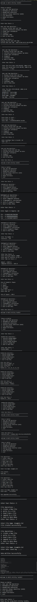

# 🧰 Moduler_&_Packager - Multi-Utility Toolkit

A Python-based menu-driven console application developed to demonstrate custom module creation, package structure, file handling, and Python standard library utilities.

---

## 👩‍💻 Author

**Drashti Vadukul**

College Student | BCA Student | Learning Python, AI, ML & Data Science

---

## 📌 Project Overview

The **Multi-Utility Toolkit** is a modular Python application that combines multiple practical utilities into a single menu-driven console interface.

It allows users to perform various operations, including date and time calculations, mathematical computations, random data generation, UUID generation, file management, and dynamic module exploration.

The application is designed to demonstrate how a large program can be divided into smaller, reusable modules. Each module focuses on a particular category of operations, making the code easier to understand, organize, maintain, and extend.

The primary purpose of this project is to strengthen practical knowledge of Python programming, custom module creation, package organization, file handling, exception handling, and built-in standard libraries.

---

## 🎯 Project Objectives

* Understand custom module creation and Python package organization.
* Develop an interactive menu-driven console application.
* Perform file operations such as creating, reading, writing, and appending.
* Work with date and time calculations and formatting.
* Implement mathematical formulas and geometric calculations.
* Generate random numbers, lists, passwords, and OTPs.
* Generate unique identifiers using UUID version 4.
* Explore Python modules dynamically using `importlib` and `dir()`.
* Practice control flow, user input, and exception handling.
* Understand how functions can be separated into reusable modules.
* Improve code readability and maintainability through modular programming.
* Integrate multiple utilities into one command-line application.

---

## ✨ Features

### 1. ⏰ Date and Time Operations

Uses Python's `datetime` and `time` modules to perform date and time-related operations.

**Functionalities:**

* **Current Date and Time:** Displays the current system date and time.
* **Date Difference:** Calculates the number of days between two dates.
* **Custom Date Formatting:** Converts dates into different formats using `strftime()`.
* **Month and Day Names:** Displays the month name and day name for a given date.
* **Stopwatch:** Measures elapsed time between the start and stop points.
* **Countdown Timer:** Displays a countdown in the terminal using `time.sleep()`.

**Python Concepts Used:**

* `datetime.datetime.now()`
* `datetime.strptime()`
* `strftime()`
* `time.time()`
* `time.sleep()`

**Example Date Formats:**

| Format     | Description     | Example    |
| ---------- | --------------- | ---------- |
| `%d/%m/%Y` | Day/Month/Year  | 09/10/2026 |
| `%d-%m-%Y` | Day-Month-Year  | 09-10-2026 |
| `%B`       | Full month name | October    |
| `%A`       | Full day name   | Friday     |

These operations demonstrate how Python can work with date values, calculate time differences, and present dates in a readable format.

### 2. 📐 Mathematical Operations

Uses Python's `math` module to perform mathematical calculations, numerical operations, and geometric computations.

**Functionalities:**

* **Factorial:** Calculates the factorial of a non-negative integer.
* **Compound Interest:** Calculates the final amount using principal, interest rate, and time.
* **Trigonometry:** Calculates sine, cosine, and tangent using angles in degrees.
* **Geometric Areas:** Calculates the areas of a circle, square, rectangle, and triangle.

**Compound Interest Formula:**

$$
A=P\left(1+\frac{r}{100}\right)^n
$$

Where:

* `P` = Principal amount
* `r` = Interest rate per compounding period, expressed as a percentage
* `n` = Number of compounding periods
* `A` = Final amount

**Geometric Area Formulas:**

| Shape     | Formula           |
| --------- | ----------------- |
| Circle    | π × radius²       |
| Square    | side²             |
| Rectangle | length × width    |
| Triangle  | ½ × base × height |

**Python Concepts Used:**

* `math.factorial()`
* `math.pi`
* `math.radians()`
* `math.sin()`
* `math.cos()`
* `math.tan()`
* `math.pow()`

Trigonometric functions in Python use radians rather than degrees, so `math.radians()` can convert an angle from degrees to radians before the calculation.

### 3. 🎲 Random Data Generation

Uses Python's `random` and `string` modules to generate random values and character combinations.

**Functionalities:**

* **Random Number:** Generates an integer between 1 and 100.
* **Random List:** Generates a list of random numbers using a user-defined size and range.
* **Password Generator:** Combines letters, digits, and special characters to create a password of the requested length.
* **OTP Generator:** Generates a six-digit numeric OTP.

**Python Concepts Used:**

* `random.randint()`
* `random.choice()`
* `string.ascii_letters`
* `string.digits`
* `string.punctuation`
* Lists, loops, and string operations

This module demonstrates random value generation, list creation, character selection, and the combination of multiple character sets.

**Security Note:** Python's `random` module is intended for general-purpose randomization, not security-sensitive authentication. A production password or OTP generator should use the `secrets` module.

### 4. 🔑 Unique Identifier Generation

Uses Python's `uuid` module to generate UUID version 4 identifiers.

**Functionalities:**

* Generate UUID v4 identifiers.
* Produce identifiers for testing and demonstration purposes.
* Understand the role of unique identifiers in software applications.

**Python Concept Used:**

* `uuid.uuid4()`

A UUID is a 128-bit identifier represented in a standard textual format. UUID v4 values are generated using random or pseudorandom data, making collisions extremely unlikely.

### 5. 📁 File Operations

Provides basic text file management using Python's built-in file handling functionality.

**Functionalities:**

* **Create File:** Creates a new empty text file.
* **Write File:** Writes new content or overwrites existing content.
* **Read File:** Reads and displays the contents of a text file.
* **Append File:** Adds new content to the end of an existing file.

**File Modes:**

| File Mode | Description                                    |
| --------- | ---------------------------------------------- |
| `w`       | Creates a file or overwrites existing content. |
| `r`       | Opens an existing file for reading.            |
| `a`       | Creates a file if needed or appends content.   |

**Python Concepts Used:**

* `open()`
* `read()`
* `write()`
* `close()`
* File modes and exception handling

File handling demonstrates how data can be stored in text files and retrieved later instead of being used only temporarily in program memory.

### 6. 🔍 Dynamic Module Exploration

Uses Python's `importlib` and `dir()` functions to import and inspect modules dynamically.

**Functionalities:**

* Accept a module name from the user.
* Import valid modules dynamically.
* Display available attributes, functions, and other names.
* Handle missing modules using exception handling.

**Examples of Modules to Explore:**

* `math`
* `os`
* `sys`
* `datetime`

**Python Concepts Used:**

* `importlib.import_module()`
* `dir()`
* `ModuleNotFoundError`
* Dynamic imports and runtime inspection

The `importlib.import_module()` function imports a module using its name as a string. The `dir()` function returns a list of names associated with the imported module.

The returned list can contain functions, constants, classes, and other attributes. It does not necessarily represent only functions or methods.

---

## 🏗️ Project Structure

```text
Project_7/
│
├── Module/
│   ├── __pycache__/
│   ├── __init__.py
│   ├── File_Operations.py
│   └── Operations.py
│
├── Main.py
├── Output.png
└── README.md
```

### 📂 File and Folder Description

| File / Folder               | Description                                                                                                        |
| --------------------------- | ------------------------------------------------------------------------------------------------------------------ |
| `Project_7/`                | Main project directory containing the application files.                                                           |
| `Module/`                   | Custom Python package containing reusable utility modules.                                                         |
| `Module/__pycache__/`       | Directory where Python may store compiled bytecode files.                                                          |
| `Module/__init__.py`        | Package initialization file.                                                                                       |
| `Module/Operations.py`      | Contains general utility operations such as date and time, mathematics, random data, UUID, and module exploration. |
| `Module/File_Operations.py` | Contains functions for text file creation, reading, writing, and appending.                                        |
| `Main.py`                   | Entry point that displays the main menu and manages user choices.                                                  |
| `Output.png`                | Screenshot demonstrating the application's execution.                                                              |
| `README.md`                 | Documentation explaining the project's purpose, structure, features, and usage.                                    |

**Note:** The `__pycache__` directory is automatically generated by Python when applicable. It is generally unnecessary to include it in a GitHub repository.

---

## 🧩 Application Architecture

The application follows a modular design in which related functionalities are separated into different files.

This structure reduces the need to place every operation inside one large Python file.

### 1. Main Application — `Main.py`

The main application file serves as the entry point.

**Responsibilities:**

* Display the main menu.
* Accept the user's selection.
* Call the corresponding utility or submenu.
* Manage the main program loop.
* Return control to the main menu after an operation.
* Exit the application when the configured exit option is selected.

### 2. Operations Module — `Module/Operations.py`

This module groups general-purpose utility functions.

**Responsibilities:**

* Perform date and time operations.
* Calculate mathematical results.
* Generate random values and data.
* Create UUID identifiers.
* Import and inspect modules dynamically.

### 3. File Operations Module — `Module/File_Operations.py`

This module manages text file operations separately from the general utilities.

**Responsibilities:**

* Create text files.
* Write content into files.
* Read existing file content.
* Append additional content.

### 4. Package Initialization — `Module/__init__.py`

This file supports the organization of the `Module` directory as a Python package.

It helps make the project structure clearer and supports importing modules from the package.

### Benefits of Modular Architecture

* **Reusability:** Functions can be imported and used where required.
* **Readability:** Related functionality is grouped together.
* **Maintainability:** Individual modules can be updated separately.
* **Organization:** The main program remains separate from utility implementations.
* **Extensibility:** Additional modules can be introduced as the project grows.

---

## 🔄 Program Flow

The application follows an interactive menu-driven workflow.

```text
             ┌──────────────────────┐
             │      Start Main      │
             └──────────┬───────────┘
                        │
                        ▼
             ┌──────────────────────┐
             │  Display Main Menu   │
             └──────────┬───────────┘
                        │
                        ▼
             ┌──────────────────────┐
             │   Get User Choice    │
             └──────────┬───────────┘
                        │
             ┌──────────┴───────────┐
             │                      │
             ▼                      ▼
     ┌──────────────────┐   ┌──────────────────┐
     │ Choices 1 to 6   │   │    Choice 7      │
     └────────┬─────────┘   └────────┬─────────┘
              │                      │
              ▼                      ▼
     ┌──────────────────┐   ┌──────────────────┐
     │ Open Selected    │   │   Exit Program   │
     │ Utility / Menu   │   └────────┬─────────┘
     └────────┬─────────┘            │
              │                      ▼
              ▼                     Stop
     ┌──────────────────┐
     │ Perform Selected │
     │    Operation     │
     └────────┬─────────┘
              │
              ▼
     ┌──────────────────┐
     │ Return to Main   │
     │       Menu       │
     └────────┬─────────┘
              │
              └──────────► Display Main Menu
```

**Workflow Explanation:**

1. The program starts from `Main.py`.
2. The main menu is displayed.
3. The user enters a menu choice.
4. The application checks the selected option.
5. The appropriate function or submenu is executed.
6. The operation processes the user's input.
7. The result is displayed in the terminal.
8. Control returns to the main menu.
9. The program stops when the exit option is selected.

*The diagram assumes that options 1–6 are utility categories and option 7 exits the application. The actual menu choices should match `Main.py`.*

---

## 🖥️ Application Output

The following screenshot demonstrates the application's execution.



The screenshot provides a visual reference for the console interface and its execution.

---

## ⚙️ Technologies Used

| Technology         | Purpose                                                      |
| ------------------ | ------------------------------------------------------------ |
| Python             | Core programming language used to develop the application.   |
| Visual Studio Code | Development environment for writing and running Python code. |
| `datetime`         | Date and time operations.                                    |
| `time`             | Time measurements and countdown functionality.               |
| `math`             | Mathematical calculations and trigonometric functions.       |
| `random`           | Random number and value generation.                          |
| `string`           | Character sets for password generation.                      |
| `uuid`             | UUID v4 generation.                                          |
| `importlib`        | Dynamic module imports.                                      |
| Git                | Version control.                                             |
| GitHub             | Source code hosting and project documentation.               |
| CLI                | Text-based interface for user interaction.                   |

---

## ▶️ How to Run the Project

### Prerequisites

Before running the application, ensure that:

* Python is installed on your system.
* Visual Studio Code or another Python-compatible editor is available.
* The complete project folder has been downloaded or cloned.
* The project files retain their original directory structure.

### Step 1: Open the Project

Open the `Project_7` folder in Visual Studio Code.

### Step 2: Open the Terminal

Open the integrated terminal and navigate to the directory containing `Main.py`.

### Step 3: Run the Application

Execute the following command:

```bash
python Main.py
```

On Windows, the following command may also be used:

```bash
py Main.py
```

### Step 4: Select an Operation

Choose an option from the displayed main menu.

### Step 5: Follow the Instructions

Enter the requested values and follow the terminal prompts to perform the selected operation.

### Step 6: Exit the Application

Choose the exit option displayed by the program to terminate the application.

**Important:** Run `Main.py` from the project root directory so that imports from the `Module` package resolve as expected.

---

## 🧠 Key Python Concepts Demonstrated

| Concept                  | Implementation in Project                                                             |
| ------------------------ | ------------------------------------------------------------------------------------- |
| Modular Programming      | Separating operations into reusable Python files.                                     |
| Custom Modules           | Creating `Operations.py` and `File_Operations.py`.                                    |
| Package Structure        | Organizing modules inside the `Module` directory.                                     |
| Package Initialization   | Using `__init__.py`.                                                                  |
| Module Imports           | Importing custom functions into the main program.                                     |
| Standard Libraries       | Working with `datetime`, `time`, `math`, `random`, `string`, `uuid`, and `importlib`. |
| File Handling            | Creating, reading, writing, and appending text files.                                 |
| Control Flow             | Using loops and conditional statements for menu navigation.                           |
| Nested Menus             | Grouping related operations under individual menu options.                            |
| User Input               | Collecting values through `input()`.                                                  |
| Exception Handling       | Handling errors with `try` and `except` where implemented.                            |
| Date Formatting          | Converting date values into readable formats.                                         |
| Mathematical Computation | Applying formulas and mathematical functions.                                         |
| Randomization            | Generating random values and lists.                                                   |
| Dynamic Importing        | Importing modules by name at runtime.                                                 |
| Runtime Inspection       | Inspecting module names using `dir()`.                                                |
| Command-Line Interface   | Building an interactive terminal-based application.                                   |

---

## 🧪 Testing Scenarios

The following scenarios can be used to check the behavior of the different utilities.

| Feature               | Test Input / Scenario                | Expected Behavior                                                |
| --------------------- | ------------------------------------ | ---------------------------------------------------------------- |
| Current Date and Time | Select the date and time option.     | Displays the current system date and time.                       |
| Date Difference       | Enter two valid dates.               | Displays the difference in days.                                 |
| Date Formatting       | Enter a valid date.                  | Displays the requested date format.                              |
| Stopwatch             | Start and stop the stopwatch.        | Displays the elapsed time.                                       |
| Countdown Timer       | Enter a countdown duration.          | Displays the countdown.                                          |
| Factorial             | Enter a non-negative integer.        | Displays the factorial result.                                   |
| Compound Interest     | Enter principal, rate, and periods.  | Displays the calculated amount.                                  |
| Trigonometry          | Enter an angle in degrees.           | Displays the selected trigonometric results.                     |
| Geometric Areas       | Select a shape and enter dimensions. | Displays the calculated area.                                    |
| Random Number         | Generate a random integer.           | Displays a number within the configured range.                   |
| Random List           | Enter list size and numeric limits.  | Displays the generated list.                                     |
| Password Generator    | Enter the requested length.          | Generates a password according to the implementation.            |
| OTP Generator         | Select the OTP option.               | Displays a six-digit numeric OTP.                                |
| UUID Generator        | Select UUID generation.              | Displays a UUID v4 identifier.                                   |
| Create File           | Enter a filename.                    | Creates a file if the operation completes successfully.          |
| Write File            | Enter a filename and content.        | Writes the content to the file.                                  |
| Read File             | Enter an existing filename.          | Displays its contents.                                           |
| Append File           | Enter additional content.            | Appends content without intentionally overwriting existing data. |
| Module Exploration    | Enter `math`.                        | Displays names associated with the module.                       |
| Invalid Module        | Enter a nonexistent module name.     | Handles the import error if exception handling is implemented.   |

**Note:** These are suggested testing scenarios, not a claim that automated tests have been executed. Actual behavior depends on the implemented code and input validation.

---

## 🛡️ Input Validation and Error Handling

Input validation helps ensure that users provide values in the expected format. Exception handling allows a program to respond to certain errors without terminating unexpectedly.

Potential validation cases in this project include:

* Entering a non-numeric value where a number is required.
* Selecting a menu option that is not supported.
* Entering a date in an invalid format.
* Providing a negative number for a factorial calculation.
* Entering invalid dimensions for a geometric calculation.
* Attempting to read a file that does not exist.
* Entering an invalid module name.
* Providing an invalid range or size for random data generation.

Python supports error handling using `try`, `except`, and appropriate exception types.

For example, `ValueError` may occur when converting an invalid string into a number, while `ModuleNotFoundError` may occur when a requested module cannot be imported.

These cases should be handled according to the requirements of each operation.

---

## 📁 File Handling: Important Details

The File Operations module demonstrates how Python works with persistent text files.

### Write Mode (`w`)

Write mode creates a file if it does not exist. If the file already exists, its previous contents are overwritten.

### Read Mode (`r`)

Read mode opens an existing file for reading. If the specified file does not exist, Python normally raises a `FileNotFoundError`.

### Append Mode (`a`)

Append mode adds content at the end of a file. If the file does not exist, Python creates it.

### Resource Management

Files should be closed after use. A `with open(...)` statement is generally recommended because it closes the file automatically when the block finishes.

These concepts are important for working with text files safely and managing file resources efficiently.

---

## 📦 Module and Package Management

Python supports organizing reusable functionality into modules and packages.

### What Is a Module?

A module is a Python file containing code such as functions, classes, and variables that can be imported into another Python file.

In this project:

* `Operations.py` contains utility-related functionality.
* `File_Operations.py` contains file management functionality.

### What Is a Package?

A package organizes related modules under a directory. The `Module` directory groups the project's utility files together.

### What Is `__init__.py`?

The `__init__.py` file can be used to initialize a package and define package-level behavior. In a conventional package structure, it also marks the directory as a regular Python package.

### Why Use Custom Modules?

Custom modules help avoid placing all program logic in one file. They improve organization, reusability, readability, and maintainability.

---

## 🔍 Dynamic Module Exploration: Technical Explanation

Dynamic importing allows a module to be selected at runtime rather than being specified only through a static import statement.

For example:

```python
import importlib

module_name = input("Enter module name: ")

try:
    module = importlib.import_module(module_name)
    print(dir(module))

except ModuleNotFoundError:
    print("Module not found")
```

### Code Explanation

* `import importlib` imports the standard library used for dynamic importing.
* `input()` accepts a module name from the user.
* `importlib.import_module()` attempts to import the selected module.
* `dir(module)` returns a list of names associated with the module.
* `except ModuleNotFoundError` handles a module that cannot be found.

This example demonstrates the underlying concept of dynamic module exploration. The complete implementation in the project may include additional prompts or output formatting.

---

## 📈 Future Enhancements

The project can be extended with additional features in future versions.

* Add stronger input validation for all utility functions.
* Improve error messages and exception handling.
* Introduce a graphical user interface using Tkinter.
* Add support for JSON and CSV file operations.
* Store operation history for later reference.
* Add automated unit tests for individual functions.
* Use `secrets` for security-sensitive password and OTP generation.
* Improve terminal output formatting.
* Add additional mathematical operations and conversions.
* Add more built-in modules to the module exploration workflow.
* Improve documentation with additional screenshots and examples.

These are possible future improvements and are not necessarily part of the current implementation.

---

## 🌱 Learning Outcomes

Through the development of the Multi-Utility Toolkit, I practiced:

* Creating and importing custom Python modules.
* Organizing Python files into a package structure.
* Understanding the purpose of `__init__.py`.
* Using Python's standard library for practical tasks.
* Implementing menu-driven console applications.
* Working with loops, conditions, and user input.
* Performing date and time calculations.
* Applying mathematical formulas through Python.
* Generating random data and UUID identifiers.
* Managing text files using file input/output operations.
* Exploring modules dynamically with `importlib` and `dir()`.
* Understanding common input and file-related errors.
* Improving code organization and problem-solving skills.
* Documenting a Python project using Markdown.
* Preparing a project for sharing through GitHub.

---

## 💡 Challenges and Practical Understanding

Developing a multi-utility application involves bringing several different programming concepts together.

Some important areas of practical understanding include:

* Keeping the main application separate from utility implementations.
* Importing functions from the correct modules.
* Maintaining the correct project folder structure.
* Processing user input in the expected format.
* Handling date, mathematical, and file-related operations appropriately.
* Understanding the difference between writing, reading, and appending files.
* Inspecting modules dynamically at runtime.
* Returning to the main menu after completing an operation.

Working with these areas provides experience in designing and organizing a structured Python console application.

---

## 🚀 Project Applications

The Multi-Utility Toolkit is primarily an educational project intended to demonstrate Python programming fundamentals.

Its individual features illustrate concepts that are also useful in larger applications:

* **Date and Time Utilities:** Understanding date calculations, formatting, and elapsed time.
* **Mathematical Utilities:** Applying formulas and calculations programmatically.
* **Random Data Generation:** Producing sample values for testing and demonstrations.
* **UUID Generation:** Creating identifiers for software experiments.
* **File Operations:** Reading and storing text data.
* **Dynamic Module Exploration:** Understanding imports and module attributes at runtime.

The application can serve as a foundation for experimenting with additional Python utilities and more advanced software design concepts.

---

## 📌 Conclusion

The **Multi-Utility Toolkit** combines multiple practical Python utilities into a single modular, menu-driven console application.

It demonstrates custom module creation, package organization, date and time operations, mathematical calculations, random data generation, UUID generation, file handling, and dynamic module exploration.

By separating related operations into different modules, the project illustrates the importance of structured programming, reusable functionality, and maintainable code.

This project represents my practical learning journey in Python programming and software development and provides a foundation for building more advanced applications in the future.

---

**Thank you for visiting my project!** ⭐
